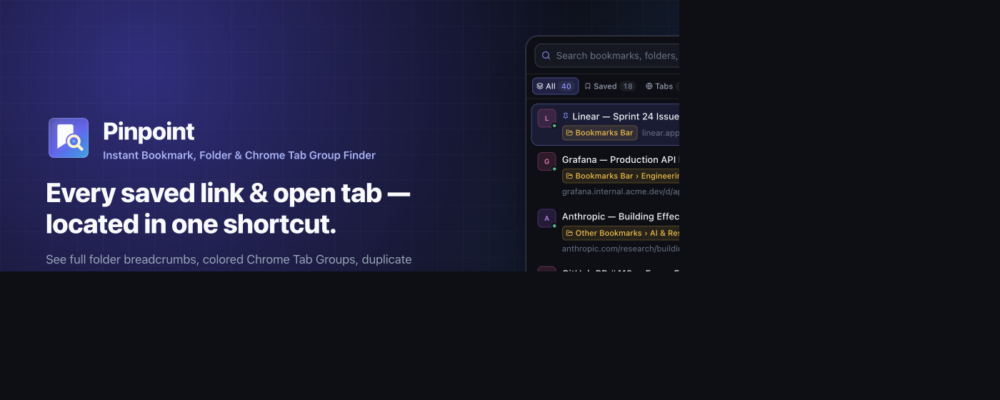
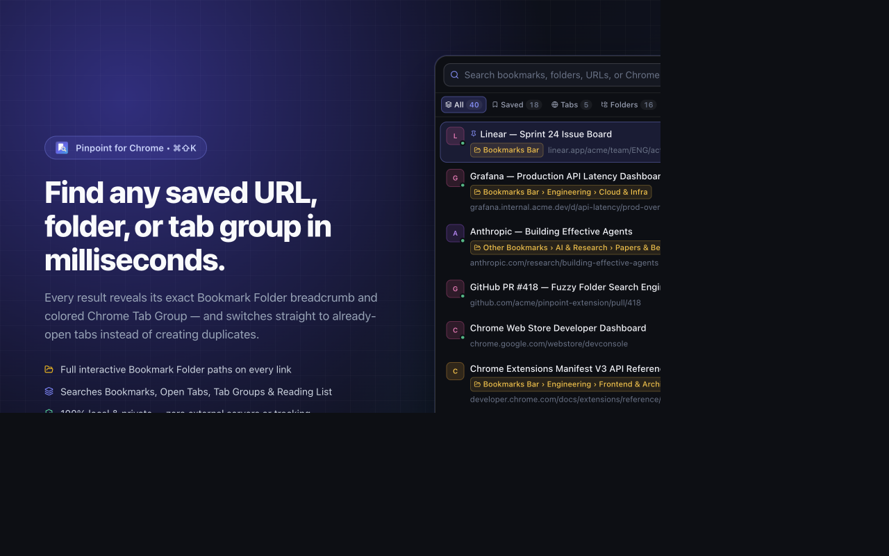
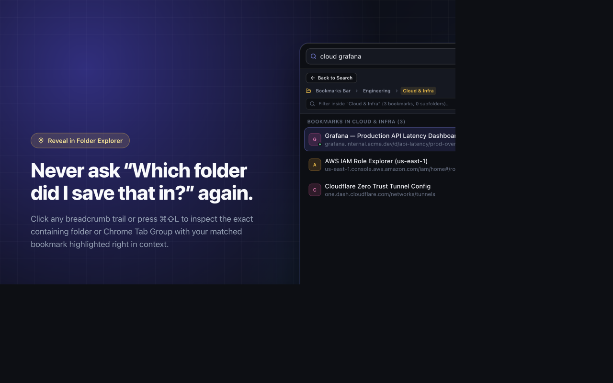
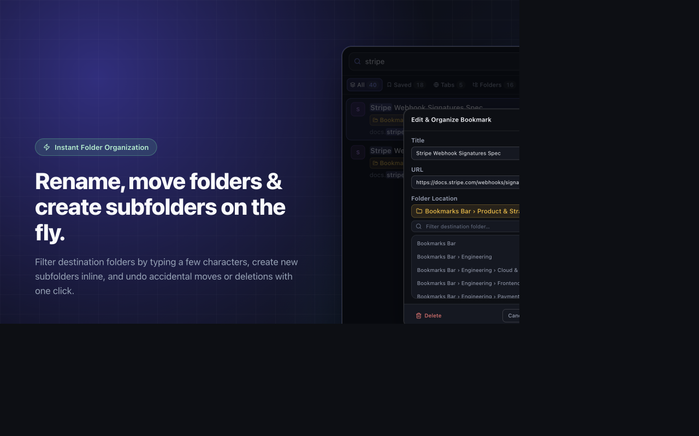
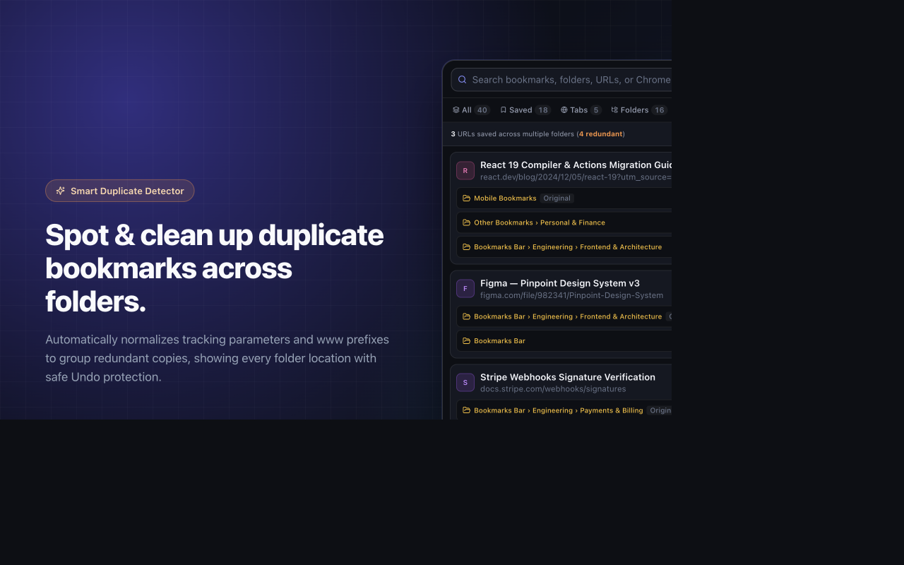
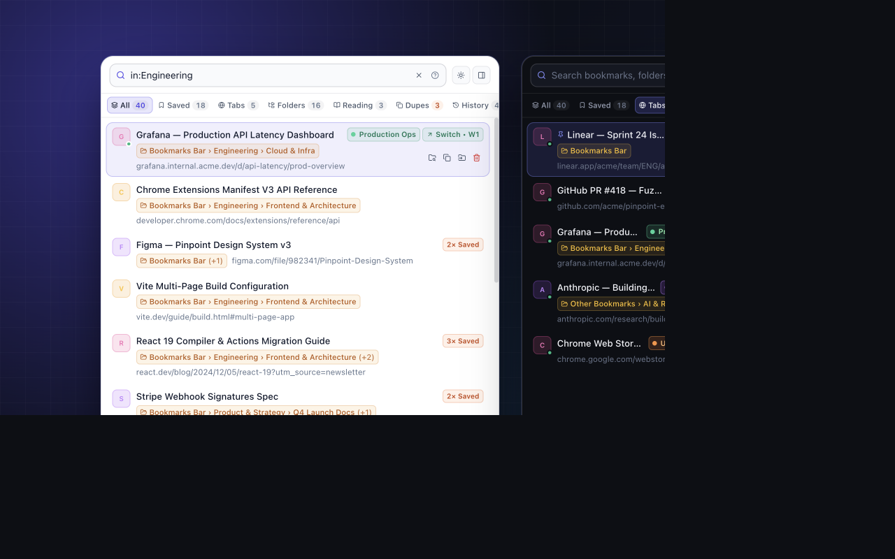
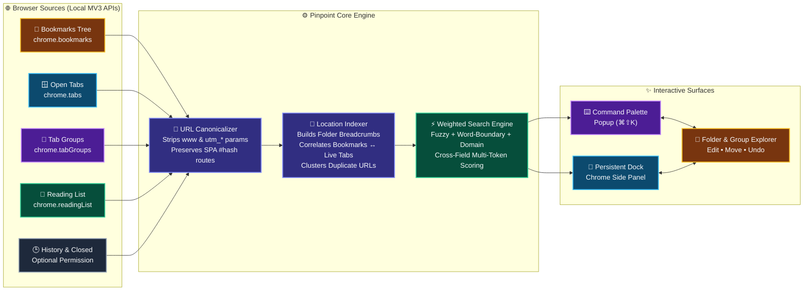
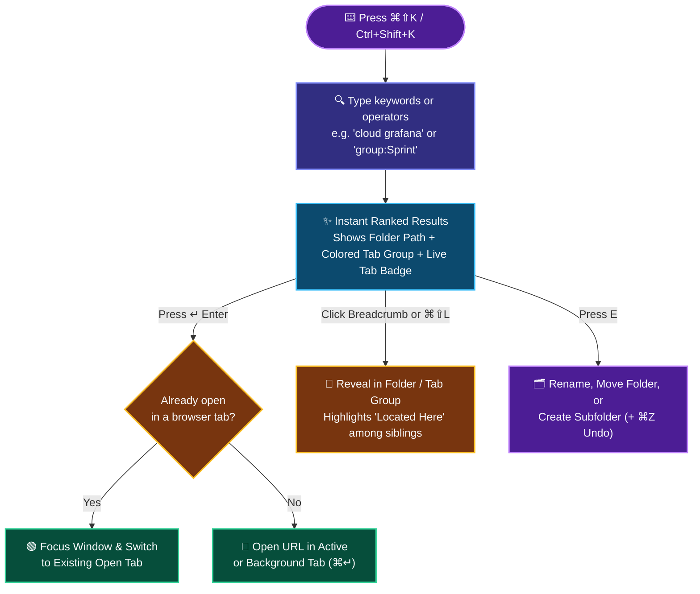

<div align="center">


# Pinpoint

### **Instant Bookmark, Nested Folder & Chrome Tab Group Search**

*Never ask “Where did I save that link, or which Chrome tab folder is it in?” again.*

[](https://chromewebstore.google.com/detail/fadblajfeigpjfddhcmipinicihkdjon)
[](#architecture--how-it-works)
[](#quick-start--installation)
[](./PRIVACY_POLICY.md)

[**Visual Tour**](#-visual-tour) · [**How It Works**](#-architecture--how-it-works) · [**Search Operators**](#-power-search-operators) · [**Keyboard Shortcuts**](#%EF%B8%8F-keyboard-first-shortcuts) · [**Install**](#-quick-start--installation)

<br />



</div>

---

## ✨ Why Pinpoint?

Browsers make it effortless to save hundreds of bookmarks across nested folders, group dozens of tabs into colored **Chrome Tab Groups**, and stash articles in your **Reading List** — yet finding *where* something lives later feels impossible.

| Everyday Browser Pain | How **Pinpoint** Solves It |
| :--- | :--- |
| 📁 *"I saved that doc somewhere, maybe under Work or Q4?"* | Shows the **full interactive folder breadcrumb** (`Bookmarks Bar › Engineering › Cloud & Infra`) right on every result. |
| 🎨 *"Which window or colored Chrome Tab Group has that tab open?"* | Displays Chrome's **exact 9 Tab Group colors + Window #** (`● Sprint 24 • W1`) and switches straight to the live tab. |
| 🔁 *"I keep opening duplicate tabs for links I already have open."* | **Cross-correlates Bookmarks ↔ Open Tabs** automatically so `Enter` jumps to your existing open tab. |
| 🧭 *"What else did I save alongside that bookmark?"* | One click (or `⌘⇧L`) opens **Reveal in Folder Explorer** with your target bookmark highlighted (`Located Here`). |
| 🧹 *"I accidentally saved the same URL in three different folders."* | **Smart Duplicate Finder** strips noisy `utm_*` & `www.` variants to clean up redundant copies with 1-click **Undo**. |
| 🔒 *"Extensions ask for scary `Read all data on all websites` permissions."* | **Zero `<all_urls>` host permissions**, zero content scripts, zero external servers, and 100% offline execution. |

---

## 🎨 Visual Tour

### 1. Unified Command Palette (`⌘⇧K` / `Ctrl+Shift+K`)
Search across **Bookmarks**, **Open Tabs**, **Colored Chrome Tab Groups**, **Folders**, **Reading List**, and (optionally) **History & Recently Closed Tabs** in a single keystroke.

<p align="center">
  
</p>

<table>
  <tr>
    <td width="50%" valign="top">
      <h4 align="center">📍 Reveal in Folder Explorer</h4>
      
      <p align="center"><sub>Click any folder breadcrumb or Tab Group badge to inspect sibling items with your target link highlighted in place.</sub></p>
    </td>
    <td width="50%" valign="top">
      <h4 align="center">⚡ Quick Edit &amp; Move-to-Folder</h4>
      
      <p align="center"><sub>Rename bookmarks, fuzzy-search destination folders, create new subfolders inline, and undo with one click.</sub></p>
    </td>
  </tr>
  <tr>
    <td width="50%" valign="top">
      <h4 align="center">🧹 Duplicate Clutter Finder</h4>
      
      <p align="center"><sub>Detects identical URLs across multiple folders (even with <code>utm_*</code> tracking differences) for effortless cleanup.</sub></p>
    </td>
    <td width="50%" valign="top">
      <h4 align="center">🌓 Light &amp; Dark Themes + Side Panel</h4>
      
      <p align="center"><sub>Use as an instant toolbar popup or dock persistently alongside your workflow in Chrome Side Panel.</sub></p>
    </td>
  </tr>
</table>

---

## 🧠 Architecture & How It Works

### Unified Local Indexing & Cross-Correlation Pipeline

Pinpoint runs **100% locally in memory** with zero external network calls. Whenever you open the palette (or as tabs and bookmarks change while docked in the Side Panel), Pinpoint builds a cross-referenced index in milliseconds:



### "Where Did I Save It?" Interaction Flow



---

## 🔎 Power Search Operators

Combine plain keywords across fields (for example, typing `engineering stripe` matches folder `Engineering` + title `Stripe`) or narrow instantly with operators:

| Operator | Example | What It Matches |
| :--- | :--- | :--- |
| `in:<folder>` | `in:Engineering` or `in:"Q4 Docs"` | Items saved inside a matching bookmark folder path |
| `group:<name\|color>` | `group:Sprint` or `group:purple` | Tabs (or bookmarked URLs currently open) in a Chrome Tab Group |
| `site:<domain>` | `site:github.com` | Links matching the specified hostname or domain |
| `is:open` | `is:open figma` | Saved bookmarks or URLs that are currently open in a browser tab |
| `is:duplicate` | `is:duplicate` | Bookmarks saved across 2 or more folders |
| `is:unread` | `is:unread` | Unread entries in your Chrome Reading List |

---

## ⌨️ Keyboard-First Shortcuts

| Action | macOS | Windows / Linux |
| :--- | :---: | :---: |
| **Launch Pinpoint anywhere** | `⌘` `⇧` `K` | `Ctrl` + `Shift` + `K` |
| **Navigate results** | `↑` / `↓` | `↑` / `↓` |
| **Open link (or switch to open tab)** | `↵ Enter` | `Enter` |
| **Open in new background tab** | `⌘` `↵` | `Ctrl` + `Enter` |
| **Reveal in Folder / Tab Group Explorer** | `⌘` `⇧` `L` | `Ctrl` + `Shift` + `L` |
| **Copy URL to clipboard** | `⌥` `C` | `Alt` + `C` |
| **Edit title / URL or Move to Folder** | `E` *(or `⌘E`)* | `E` *(or `Ctrl+E`)* |
| **Undo last move or deletion** | `⌘` `Z` | `Ctrl` + `Z` |
| **Back from Explorer / Clear / Close** | `Esc` | `Esc` |

> 💡 *Tip: You can customize the global launch shortcut anytime at `chrome://extensions/shortcuts`.*

---

## 🚀 Quick Start & Installation

### Option A — Chrome Web Store
Install directly from the **[Chrome Web Store](https://chromewebstore.google.com/detail/fadblajfeigpjfddhcmipinicihkdjon)** *(compatible with Google Chrome, Brave, Arc, Microsoft Edge, and Vivaldi)*.

### Option B — Build & Load Unpacked from Source

```bash
git clone https://github.com/rupeshdevbox/Pinpoint.git
cd Pinpoint
npm install
npm run build
```

This outputs validated extension bundles and release archives:
- **Chrome / Chromium MV3**: `dist/chrome/` & `releases/pinpoint-chrome-v1.0.0.zip`
- **Firefox MV3**: `dist/firefox/` & `releases/pinpoint-firefox-v1.0.0.zip`

**Load in Chrome / Brave / Arc / Edge:**
1. Open `chrome://extensions` and enable **Developer mode** (top-right).
2. Click **Load unpacked** and select `dist/chrome`.
3. Pin **Pinpoint** to your toolbar and press **`⌘⇧K`** / **`Ctrl+Shift+K`**.

**Load in Firefox:**
1. Open `about:debugging#/runtime/this-firefox`.
2. Click **Load Temporary Add-on…** and select `dist/firefox/manifest.json`.

---

## 🛠️ Project Structure & Development

```text
Pinpoint/
├── public/icons/             # Supersampled 16/32/48/128 PNGs & vector brand SVG
├── src/
│   ├── adapters/             # Chrome + Firefox MV3 WebExtension adapter & preview mock workspace
│   ├── background/           # MV3 service worker (Side Panel behavior & cross-window tab focus)
│   ├── components/           # Command Palette, ResultCard, FolderExplorer, EditModal, DuplicateFinder
│   ├── constants/            # Brand config & official 9-color Chrome Tab Group palettes
│   ├── engine/               # URL canonicalizer, breadcrumb/tab-group indexer & fuzzy search engine
│   ├── manifest/             # Target-specific Chrome & Firefox Manifest V3 builder
│   └── styles/               # Semantic Light/Dark theme design tokens & Tailwind CSS v4
├── scripts/                  # Icon generator, multi-browser ZIP bundler & CWS API v2 publisher
├── store-assets/             # 1280×800 screenshots & promo tiles (24-bit RGB PNG)
└── tests/                    # Automated Vitest unit & integration test suites
```

```bash
npm run dev         # Launch interactive browser preview studio (Popup + Side Panel switcher)
npm run typecheck   # Run strict TypeScript compiler validation
npm test            # Run Vitest unit & integration test suites
npm run build       # Build Chrome & Firefox bundles + release .zip packages
```

---

## 🔒 Privacy

Pinpoint processes your bookmarks, open tabs, tab groups, and Reading List **strictly locally inside your browser**. No user data, URLs, or search queries are ever collected, transmitted, or shared. Read the full [Privacy Policy](./PRIVACY_POLICY.md).

